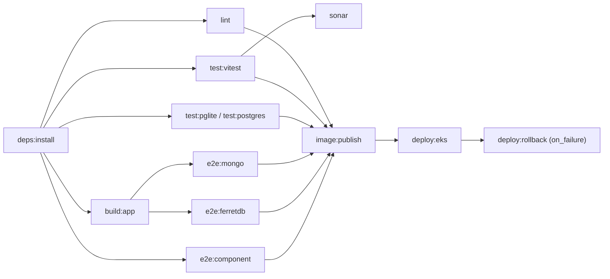

# Migrate Aletheia CI/CD from GitHub Actions to GitLab CI

> [!IMPORTANT]
> **Status: deferred (2026-11-03).** Work moved to fixing CI on GitHub Actions
> (Cypress flakiness, build-once, dependency caches, untracked `.yarn/cache`).
> This document keeps the GitLab design and the review findings for whoever
> picks it up again.

## Why it was deferred

| Fact | Measured | Consequence |
| --- | --- | --- |
| GitLab group plan | `aletheiafact` is on **GitLab Free**: 400 compute min/month, `saas-linux-small` = 2 vCPU / 8 GB | Not enough for any full pipeline |
| GitLab for Open Source program | Not applied | No 50k minutes, no pull mirroring, no protected-environment approvals |
| CI volume | 171 `nodejs.yml` runs in 30 days, ~50 runner-min each (~8,500 min) | 20x the free quota; above Premium's 10,000 too |
| Deploy volume | 41 `aws.yml` runs in 30 days (34 `stage`, 7 `master`) | Build + deploy (~10 min) on GitLab alone exceeds 400 min |
| GitHub runners | Free and unlimited for this public repo, 4 vCPU / 16 GB | Moving CI loses capacity and gains nothing in speed |
| Real wall time | Last `stage` run: 16.5 min wall, ~50 runner-min | The earlier estimate (~30 min wall, ~100 runner-min) was 2x too high |
| Fork PRs | 11 of the last 100 merged PRs | GitLab CI for external repos never builds fork PRs |
| Real CI pain | Cypress flakes in `personality`, `review`, `event` specs: live Wikidata calls, cross-spec data, 65 s timeouts | A test problem; moving CI providers would not fix it |
| `.yarn/cache` | Committed in Sept 2023 with the Yarn 3 upgrade (`6ef87b26`) as zero-installs | Not a Cypress workaround; removed on GitHub |

## Viable paths if this is revived

1. **Deploy-only on GitLab (fits Free).** GitHub keeps tests and builds and
   pushes the image to ECR. When CI is green on `stage`/`master`, a GitHub job
   pushes the ref to GitLab (or calls a pipeline trigger), and GitLab runs only
   the ~2 min `kubectl apply` + `rollout status` job, close to the infra repos.
   About 80 min/month.
2. **Self-hosted GitLab runner on the existing EKS cluster** (Helm, Terraform in
   `terraform-modules/infrastructure`). No minute limits; deploys can use IRSA
   instead of static AWS keys. Restrict it to protected branches, because
   untrusted MR code must never run inside the production cluster.
3. **Full CI on GitLab** only with option 2 or the OSS program, and with a
   GitHub Actions job kept for fork PRs.

### Mirror mechanics (GitHub -> GitLab)

- **Push mirror from a GitHub Action** (works on Free): on push, `git push`
  the ref to GitLab with a project access token (`write_repository`). It's
  immediate and can push same-repo PR branches as well.
- **GitLab pull mirror / "CI/CD for external repo"** needs Premium or the OSS
  program. It reports commit status back to GitHub but skips fork PRs.
- Either way, GitLab branches must be write-protected for everyone except the
  mirror, or the mirror diverges. Commit status back to GitHub needs the GitLab
  GitHub integration (Premium) or a job that calls the GitHub statuses API.

## Corrections to the earlier draft

Fix these before reusing any of the earlier YAML:

- **pkl** is `0.28.2` in `aws.yml`, not `0.25.2`.
- **ESLint** takes one `--format` per run, and `--format gitlab` needs
  `eslint-formatter-gitlab`, which is not installed. Run a second pass or drop
  the code-quality widget.
- **Coverage regex** `All files[^|]*\|...` matches the `text` reporter, not
  `text-summary`. Add `text` or change the regex to `Statements\s*:\s*([\d.]+)%`.
- **mongodb-memory-server** downloads a ~100 MB `mongod` per job. Cache
  `MONGOMS_DOWNLOAD_DIR` keyed on `MONGOMS_VERSION`.
- **Workflow rules** only built MRs and protected branches. In mirror mode
  there are no MRs, so pushed feature branches got no pipeline, and
  `docker:verify` (MR-only) never ran.
- **`ufpb-labcheck`** has no `deployment/config/config-file/*.pkl` or
  `deployment/k8s/*.pkl`; its deploy path is already broken on GitHub.
- **Deploy** applies the whole `deployment/` directory (`app.yml` and
  `websocket.yml`), and the build step must keep the `migrate-mongo-config`
  `sed` substitution.
- **The Cypress binary** lives in `~/.cache/Cypress` in the build stage and
  never reached the final image. `CYPRESS_INSTALL_BINARY=0` saves build time,
  not image size.
- **Dependabot** (security updates are enabled on GitHub) was missing from the
  feature mapping. GitLab needs Renovate or GitLab Dependency Scanning instead.
- **Terraform state:** the infra repos use an S3 backend
  (`aletheia-terraform-state`) with a local, manual `apply` (see
  `infrastructure/production/APPLY.md`) and modules from
  `terraform-module-s3`. GitLab project settings should follow that
  convention, not GitLab-managed state.
- **Runner size:** `saas-linux-small` (8 GB) is likely too small for
  `next build` plus e2e. Plan for `saas-linux-medium-amd64` (2x cost factor).

## Pipeline design (reusable)

DAG with `needs:` edges, one writer per cache, and caches separated for
protected branches (`ci_separated_caches=true`, `unprotect: false`):

| Cache | Key | Paths | Writer |
| --- | --- | --- | --- |
| node_modules | `nm-node20-<hash(yarn.lock, .yarnrc.yml)>` | `node_modules/`, `.yarn/install-state.gz` | `deps:install` |
| yarn zips | `yarn-zips-v1` | `.yarn/cache/` | `deps:install` |
| Cypress binary | `cypress-<version>` | `.cache/Cypress/` | `deps:install` |
| MongoDB binary | `mongoms-<MONGOMS_VERSION>` | `.cache/mongodb-binaries/` | first test job |
| Next build | `next-<ref>`, fallback default branch | `dist/.next/cache/` | `build:app` |
| lint | `lint-<ref>`, fallback default branch | `.cache/eslint/`, `.cache/tsc/` | `lint` |

Artifacts: `dist/` without `dist/.next/cache` (~200 MB, under the 1 GB limit),
JUnit/Cobertura reports, `coverage/lcov.info` for Sonar, and e2e screenshots
on failure.

Other decisions worth keeping:

- Kratos in e2e: GitLab `services:` can't bind-mount `ory_config/`. Run the
  pinned `kratos v0.13.0` binary with `dsn: memory` (from `ory_config/kratos.yml`)
  instead of Docker-in-Docker.
- Deploy jobs: `interruptible: false`, `resource_group: deploy-$CI_COMMIT_BRANCH`,
  and gated by a protected `DEPLOY_ENABLED` variable during any shadow period.
- AWS: environment-scoped, masked, protected variables at first; later, OIDC
  (`id_tokens` + `assume-role-with-web-identity`) with an IAM role trusted for
  `project_path:aletheiafact/aletheia:ref_type:branch:ref:{stage,master}`.
- Project settings as code (`gitlab_project`, branch protection, environments,
  variables, schedules) with values only from sensitive inputs.

## Open decisions

- Gate deploys on tests (today a red `stage` still deploys). This applies to
  GitHub too: `aws.yml` could use `workflow_run` on a successful `Aletheia CI`.

## Resolved

- Node version: every job uses `.node-version` (20.18.0, the production
  image) since `b35907e8`; the Node 22 pin from `35a945df` is gone.
